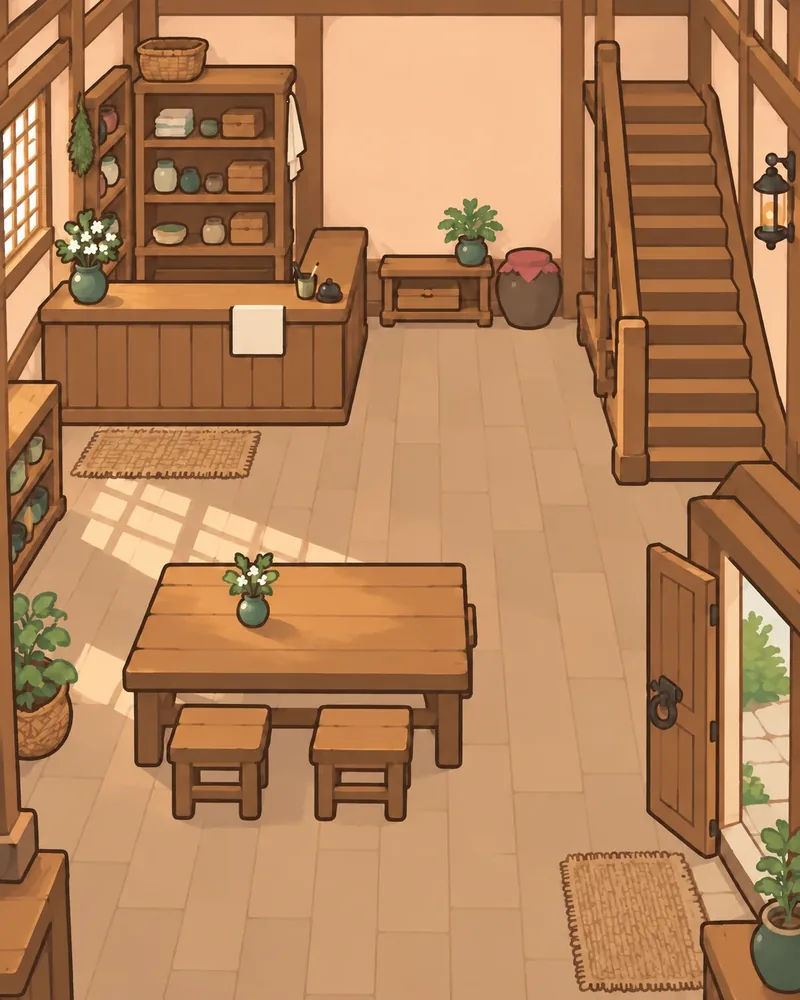

# C 화풍 어셋 제작 가이드 v0.1

작성: 2026-11-01. 기준: main `96ceb0d2437909acc9bce5f32ca7c1011efcb656`의 레이어 C 여관 로비.

새 배경·기물·인물을 **같은 세계에 놓인 그림처럼** 제작하기 위한 기준이다. C는 그림책형 레트로 RPG 화풍이다. 기존 본편 그림을 일괄 교체하는 지시가 아니며, 이번 문서 작성에서는 실행 코드나 자산을 변경하지 않는다.

상위 기준은 [디자인 원칙 v0.3](DESIGN-PRINCIPLES-v0.3.md)이다. 장소의 생활감과 상호작용을 우선한다. 공간 좌표의 의미는 [월드 공간 데이터 설계](WORLD-SPATIAL-DATA-DESIGN-v0.1.md), 현재 로비의 구현·검증 이력은 [레이어 시험 기록](INN-LOBBY-LAYERS-TEST-v0.1.md)을 따른다. 기존 [북쪽 숲 SVG 가이드](NORTH-FOREST-OBJECT-ART-GUIDE-v0.1.md)와 [아이콘 가이드](ICON-ASSETS-v0.1.md)는 해당 용도에서 유지한다.

## 1. 기준 그림과 우선순위

기준은 폐기한 A/B/C 비교판의 C가 아니라 **광원 수정 후의 레이어 C 합성**이다. 다음 제작에도 실제 참조 그림을 전달한다. “그림책형 레트로 RPG”라는 말만으로 화풍이 재현된다고 가정하지 않는다.



|참조|판단할 내용|
|---|---|
|[현재 배경 원본](../inn-layer-test/assets/background-light-v2.webp)|구도, 시점, 선, 색면, 공간의 빛을 판단한다.|
|[합성 화면](../inn-layer-test/evidence/lighting-live.jpg)|배경과 인물·기물의 상대 크기, 실제 화면에서의 밀도를 판단한다.|
|[주인 원본](../inn-layer-test/assets/keeper.webp)|얼굴·복장·색·손 표현의 연속성을 판단한다. 카운터용 상반신이며 전신 비례의 기준은 아니다.|
|[찻주전자](../inn-layer-test/assets/teapot.webp) · [찻잔](../inn-layer-test/assets/cup.webp) · [장부](../inn-layer-test/assets/ledger.webp)|재질과 실루엣을 참고하되 확대본의 잔질감까지 의무적으로 복제하지 않는다.|
|[게시판](../inn-layer-test/assets/board.webp) · [첫 종이](../inn-layer-test/assets/notice.webp) · [새 의뢰 종이](../inn-layer-test/assets/notice-new-brick.webp)|동일 물건의 상태와 서로 다른 물건을 구별한다.|
|[구성 데이터](../inn-layer-test/scene.json) · [모바일 변환 명세](../inn-layer-test/assets/mobile/manifest.json)|좌표·조건·그림 경로·최적화 결과의 실제 값을 확인한다.|

판단이 충돌하면 **모바일 합성에서의 가독성 → 기존 공간과의 일치 → 단독 그림의 세부 묘사** 순으로 결정한다. 현재 자산에도 개선 여지는 있다. 확대된 기물의 촘촘한 붓결이나 작은 외곽 잔색을 새 자산의 필수 특징으로 삼지 않는다.

## 2. 화풍의 공통 문법

|요소|제작 기준|피할 결과|
|---|---|---|
|형태|둥글고 단순한 큰 덩어리로 먼저 읽히게 한다. 손잡이·주둥이·접힌 종이처럼 식별에 필요한 특징을 남긴다.|작게 보면 구분되지 않는 장식과 미세한 요철을 늘리지 않는다.|
|윤곽|짙은 갈색 계열의 손그림 선을 쓴다. 외곽은 내부선보다 분명하게 하고, 같은 거리의 물건은 합성 시 선 굵기를 맞춘다.|순검정의 굵은 스티커 테두리, 흐릿하게 사라지는 외곽을 피한다.|
|색면|크림색 벽·황토와 갈색 목재·세이지 녹색·탁한 벽돌색을 기준 관계로 삼는다. 넓은 중간색 면을 유지한다.|네온색, 모든 물건의 강한 채도, 화면 전체의 누런 필터를 피한다.|
|명암|큰 밝은 면·중간 면·그늘이 먼저 읽히게 한다. 반사는 작고 부드럽게 둔다.|사진 같은 광택, 금속성 번쩍임, 입체 렌더처럼 과한 음영을 피한다.|
|질감|수채·과슈 같은 약한 색 변화로 재질을 암시한다. 물건 이름을 알아보는 데 필요한 만큼만 남긴다.|나뭇결·종이 섬유·피부 질감을 빽빽하게 그리지 않는다.|
|정서|사용 흔적이 있는 조용한 생활 공간을 만든다. 온기와 정돈되지 않은 작은 흔적을 함께 둔다.|모든 물건이 새 상품처럼 반짝이거나 과장된 판타지 장식으로 가득 차지 않게 한다.|

색 이름은 방향을 설명하는 말이며 고정된 전역 색상표가 아니다. 실제 제작 때 기준 배경에서 색을 추출하고 옆에 합성해 판단한다. 다른 장소는 숲의 녹색, 작업장의 돌·금속처럼 재질과 색 비중을 달리할 수 있다. 선·형태·명암의 단순화 수준은 공유한다. 픽셀 격자나 최근접 확대를 강제하지 않는다.

## 3. 시점과 배치

현재 로비는 위에서 비스듬히 내려다보는 고정 시점이다. 탁자 상판과 그릇 입구가 보이고, 뒤쪽 물건은 작게 읽힌다. 엄밀한 등각 투영이라고 단정하거나 임의의 카메라 각도로 다시 만들지 않는다. 탁자 모서리·선반·바닥선을 참조해 새 그림의 면 방향을 맞춘다.

- 여관 장면은 4:5 표시 틀을 사용한다. 현재 원본은1122×1402이고 실행용은800×1000이다. 다른 장소의 화면 비율까지4:5로 고정하지 않는다.
- `placements`의 x·y는 **투명 여백을 포함한 그림 박스의 왼쪽 위**이고 w·h는 장면 폭·높이에 대한 백분율이다. 바닥 접점 좌표나 실제 세계 좌표가 아니다.
- 새 자산은 제작 전에 예상 표시 크기를 정한다. 같은 위치의 기존 물건을 기준으로 선 굵기·상판 각도·접지 높이를 비교한다.
- 상태별 대체 그림은 캔버스 크기, 투명 여백, 접점과 중심을 맞춘다. 파일마다 자동으로 바짝 잘라내면 전환 시 물건이 튄다.
- 현재 렌더러는 지정 박스를 채운다. 새 자산은 박스의 실제 가로세로 비율에 맞춰 준비한다. 기존 자산의 늘어남을 고치려면 별도 변경으로 검수하며, 제작 과정에서 좌표를 몰래 조정하지 않는다.

예를 들어 현재 찻주전자의 박스는 장면 폭9.7%·높이7.4%다. 장면400×500에서는38.8×37 CSS px로 표시된다. 파일 자체의 비율과 다르므로 원본만 보고 크기나 선 굵기를 승인하지 않는다. 원근상 뒤에 있는 작은 기물을 터치44px에 맞춰 그림까지 크게 그리지 않는다. 터치 영역을 별도로 확보한다.

향후 자산 작업서에는 박스 외에도 바닥 접점·벽 부착점·가려질 부분을 기록한다. 이는 제작 메모이며 현재 `scene.json`에 앵커 필드가 이미 구현됐다는 뜻은 아니다.

## 4. 광원과 그림자

**여관 로비의 주광원은 왼쪽 창문이다.** 왼쪽 창문의 격자 빛과 식물 그림자를 기준으로 삼는다. 새 물건의 밝은 면과 투사 그림자는 주변의 같은 평면에 놓인 물건을 따라간다. 바닥·탁자·벽의 투영이 다르므로 모든 그림자를 화면상의 같은 각도로 복사하지 않는다.

오른쪽 출입문은 부드러운 보조광·반사광만 받는다. 출입문에서 바닥으로 새 격자 빛이나 강한 긴 그림자를 만들지 않는다. 실내 등불도 현재 장면에서 낮의 주광원과 경쟁하지 않는다.

다른 장소는 제작 전에 주광원의 위치와 성격을 별도로 정한다. “항상 왼쪽 빛”은 전역 화풍 규칙이 아니다. 이미 정한 공간의 광원은 상태별 기물마다 바꾸지 않는다.

|그림자 종류|소유·합성 기준|
|---|---|
|고정 구조의 그림자|배경에 포함한다.|
|사물 바로 아래의 접지 그림자|사물과 함께 사라져야 한다. 기본적으로 같은 투명 자산에 약하게 포함한다.|
|넓게 드리우거나 다른 사물에 가려지는 그림자|필요하면 별도 자산으로 분리하고 대상과 표시 조건을 함께 관리한다. 현재 로비의 필수 레이어라고 가정하지 않는다.|
|카운터처럼 인물을 가리는 전경|현재 배경의 같은 픽셀과 같은 좌표를 재사용한다. 별도로 다시 그려 경계가 이중으로 보이게 하지 않는다.|

사물을 숨겼을 때 배경에 그 사물의 그림자만 남으면 수정한다. 반대로 이미 배경에 있는 그림자 위에 같은 그림자를 더해 이중으로 어두워지지 않게 한다.

## 5. 자산 종류별 제작 계약

|종류|제작할 내용|분리할 내용|
|---|---|---|
|배경|벽·바닥·창문·계단 등 고정 구조와 고정 조명을 그린다.|상태에 따라 생기는 게시판·종이·짐·인물을 굽지 않는다.|
|기물|실루엣·재질·접점을 보여주는 독립 투명 그림을 만든다.|배경 조각·큰 바닥판·UI 테두리를 함께 그리지 않는다.|
|인물|역할·복장·얼굴·머리 모양을 유지하고, 필요한 자세와 가림 범위를 제작한다.|카운터나 가구를 인물 그림에 합치지 않는다.|
|생활 흔적|물기·흙·젖은 자국을 낮은 대비로 표현하고 위치를 읽을 단서를 남긴다.|비 상태를 이유로 로비 전체 배경을 다른 완성 그림으로 교체하지 않는다.|
|전경|가림에 필요한 부분만 같은 좌표로 표시한다.|배경과 다른 선·색·원근으로 재해석하지 않는다.|
|글과 UI|읽어야 하는 번체 중국어와 한국어는 DOM/UI에서 선명하게 표시한다.|생성 그림 속 가짜 한자에 학습 내용이나 의뢰 판정을 맡기지 않는다.|

주인은 묶은 갈색 머리, 붉은 작업복, 밝은 앞치마와 온화한 표정을 유지한다. 새 손님에게 같은 얼굴을 복제하지 않는다. 전신 손님을 만들 때는 별도의 전신 비례·발 접점 기준부터 확정한다. 소년의 걷기 아바타는 현재 범위가 아니다.

기존 첫 게시물은 흰색이고 새 의뢰는 **별개의 벽돌색 쪽지**다. 새 의뢰 OFF는 벽돌색 쪽지를 제거한다. 첫 종이를 붉게 바꾸는 동작이 아니다. 색 외에도 종이의 추가·위치·대화 내용으로 변화를 읽을 수 있어야 한다. 게시판 설치와 큰비는 독립 사건이다.

현재 배경에 포함된 식탁·화분 등도 향후 움직여야 한다면 먼저 배경에서 제거하고 독립 자산으로 만든다. 기존 그림 위에 같은 물건을 중복 배치하지 않는다.

## 6. 투명 자산과 원본 보존

실제 알파 채널을 사용한다. 흰색·검은색·체커보드가 그려진 배경은 투명이 아니다. 외곽의 옅은 색 테두리, 잘린 손잡이·머리카락, 바닥 접점의 뜬 느낌을 밝은 바탕·어두운 바탕·실제 공간에서 각각 확인한다.

생성 PNG 등 편집용 원본을 보존하고, 저장소의 승인 원본과 모바일 파생 파일을 구분한다. 현재 로비는 `assets/*.webp`를 승인 원본으로 관리한다. 실행용 저용량 파일을 다시 편집 원본으로 삼거나 반복 압축하지 않는다.

파일명은 `notice-new-brick.webp`처럼 대상·변형을 드러낸다. 그림 수정 버전과 사물 ID는 구별한다. `background-light-v2.webp`로 그림이 바뀌어도 `inn.lobby.structure`의 정체성은 유지한다. 새 파일·해시를 명세에 등록하고 사용하지 않는 파생 자산은 참조를 확인한 뒤 정리한다.

현재 `counter-front.svg`는 이전 배경을 내장한 보존 자산이다. 실행판 전경의 기준은 **현재 room.src와 scene.json의 clipPath**다. 오래된 SVG를 새 배경 위에 다시 올리지 않는다.

## 7. 구성 데이터 연결과 모바일 변환

`assets`는 그림 경로, `placements`는 표시 박스, `conditions`는 표시 조건, `interactions`는 터치·대화, `objects`는 안정 ID와 이 참조들을 연결한다. 파일명이나 화면 색을 보고 사건 상태를 추론하지 않는다. 화풍 수정만으로 사물 ID·배치·상태·터치 영역을 함께 바꾸지 않는다.

레이어 이름만으로 앞뒤가 결정되지는 않는다. 현재 렌더러의 `z`를 확인한다. 배경0, 물기5, 게시판10–13, 주인20, 카운터30, 기물40–42가 현재 로비의 예다. 다른 공간은 가림 관계에 맞게 정한다.

현재 변환 명령은 다음과 같다. Pillow가 필요하다.

```sh
python tools/build-inn-mobile-assets.py
```

|항목|현재 로비의 실행 기준|
|---|---|
|최대 장면|400×500 CSS px를 기준으로 계산한다.|
|배경|800×1000 이내로 축소하고 WebP quality82를 사용한다.|
|투명 기물·인물|최대 장면에서 배치 박스의 가로·세로 각각3배를 목표 상자로 삼아 비율을 유지하며 축소한다. 목표 상자의 각 변은 최소64px이며 결과의 두 변이 모두64px 이상이라는 뜻은 아니다. WebP quality86을 사용한다.|
|그림자·투명도|변환 후에도 알파 경계와 반투명 그림자가 남는지 확인한다.|
|전경|같은 모바일 배경 URL을 clipPath로 재사용해 중복 요청을 줄인다.|
|예산|현재 그림 파일 합계는104,042 bytes다. 자동검사는 중복 URL을 제외한160,000 bytes 미만을 요구한다.|
|명세|원본 SHA-256을 확인하고 `assets/mobile/manifest.json`에 변환 크기·품질·해시·용량을 기록한다.|

이는 현재 로비의 기준이며 모든 장소에 동일한 용량을 강제하는 전역 규칙은 아니다. 예산을 늘릴 때는 실제 화면 크기와 다운로드·디코딩 비용을 확인한다. 파일 크기를 로딩 시간으로 바꾸어 보고하지 않는다. 투명 여백이 지나치게 크면 실제 물체의 해상도가 낮아지므로 변환 전 점검한다.

## 8. 제작 작업서와 프롬프트

새 작업마다 아래 항목을 먼저 채운다. 상태 변화에 필요하지 않은 장식부터 늘리지 않는다.

```text
대상 / 안정 ID:
목적: 플레이어가 무엇을 알아보고 어떤 행동을 하는가?
종류: 배경 / 기물 / 인물 / 흔적 / 전경
참조: 현재 공간 배경 + 합성 화면 + 가장 가까운 기존 자산
유지할 것: 구도, 인물 정체성, 선, 색, 배치 등
변경할 것: 이번 작업의 한정된 수정 범위
시점 / 주광원 / 접지 평면:
표시 박스 / 예상 CSS 크기 / 투명 여백 / 접점:
가림 관계 / 그림자 소유:
등장 조건 / 사라질 조건 / 함께 변할 자산:
원본 경로 / 실행 경로 / 검수 결과:
```

공통 화풍 프롬프트 예시다. 실제 참조 이미지를 반드시 함께 제공한다.

```text
Match the attached current layered-C inn reference: a quiet storybook retro RPG,
rounded readable shapes, warm dark-brown hand-drawn outlines, broad muted color
planes, restrained gouache texture and simple soft shading. Match the reference
camera, apparent outline weight and level of detail at the intended mobile size.
Preserve a lived-in, calm atmosphere. No pixel-art grid, photorealistic rendering,
3D gloss, neon colors, UI frame or baked-in readable text.
```

투명 기물 제작에는 다음 내용을 붙인다.

```text
Create only [OBJECT] for [EXACT LOCATION / PLANE] in the attached scene.
Match [NEIGHBORING OBJECT] for perspective, scale and material treatment.
Key light: [SCENE-SPECIFIC LIGHT]. Include only a subtle contact shadow that
belongs to this object. Actual transparent background; no floor, wall, room,
checkerboard pattern or opaque matte. Keep the full silhouette and agreed
padding/contact point. Target placement: [CSS WIDTH × HEIGHT / CANVAS RATIO].
```

기존 그림 수정에는 다음 내용을 붙인다.

```text
Edit the attached existing asset; it is the edit target, not general inspiration.
Change only [SPECIFIC REGION / ATTRIBUTE]. Preserve framing, perspective,
furniture placement, silhouettes, palette and outline character elsewhere.
Do not add or remove unrelated objects. Preserve transparency and padding when
present. For this inn, retain the left-window key light and its lattice/plant
shadows; the right doorway supplies only soft ambient fill.
```

프롬프트는 검수의 대체물이 아니다. 부분 편집도 다른 부분의 붓결·윤곽을 바꿀 수 있다. 수정 전후를 겹쳐 구도와 물건 위치를 확인하고, 의도 밖 변화가 크면 재작업한다.

## 9. 제작 순서와 완료 기준

1. 최신 구성 데이터와 기준 그림을 읽고 작업서를 작성한다. 이전 시험판을 새 기준으로 되살리지 않는다.
2. 기존 그림을 수정할 때는 그 파일을 입력으로 사용한다. 신규 기물도 공간 배경과 가까운 자산을 함께 참조한다.
3. 원본을 보존하고 단독 그림의 알파·실루엣·접점부터 확인한다. 상태 대체본은 캔버스와 정렬을 비교한다.
4. 실제 위치에 합성해 선·시점·빛·가림을 조정한다. 배경과 별개로 예쁜지만 보고 승인하지 않는다.
5. 구성 참조와 원본 명세를 갱신하고 모바일 파생 파일을 재생성한다.
6. 375×812와360×640에서 정상 크기로 본다. 작은 기물 식별, 최소44px 터치와 겹침 우선순위, 대화 중 공간 가시성을 확인한다.
7. 관련 사건 조합을 전환한다. 현재 로비는 게시판·큰비·새 의뢰8조합을 확인한다. 숨긴 물건·그림자·터치 영역이 함께 사라지고 나머지 공간은 흔들리지 않아야 한다.
8. 관련 자동검사와 공개 배포 검증을 마친다. 실제 iPhone Safari 사용자 승인은 자동검사와 구분해 기록한다.

현재 로비에서 쓰는 검사 명령은 다음과 같다. 브라우저 검사는 Playwright와 해당 브라우저 설치가 필요하다.

```sh
node --test tests/inn-layer-model.test.cjs
node tools/verify-content.cjs
python tests/smoke_inn_layers.py
BROWSER=webkit python tests/smoke_inn_layers.py
```

납품에는 승인 원본·투명 자산, 실행용 파생 파일, 구성 데이터·명세, 사용한 참조와 최종 프롬프트, 수정 전후 또는 상태별 합성 화면, 용량·검사·배포 결과를 함께 남긴다. 문서만 작성하는 작업에 새 그림이나 배포를 요구하지 않는다. 실제 자산 작업의 완료는 모바일 공간에서 의도한 모습과 행동이 확인됐을 때 판단한다.
